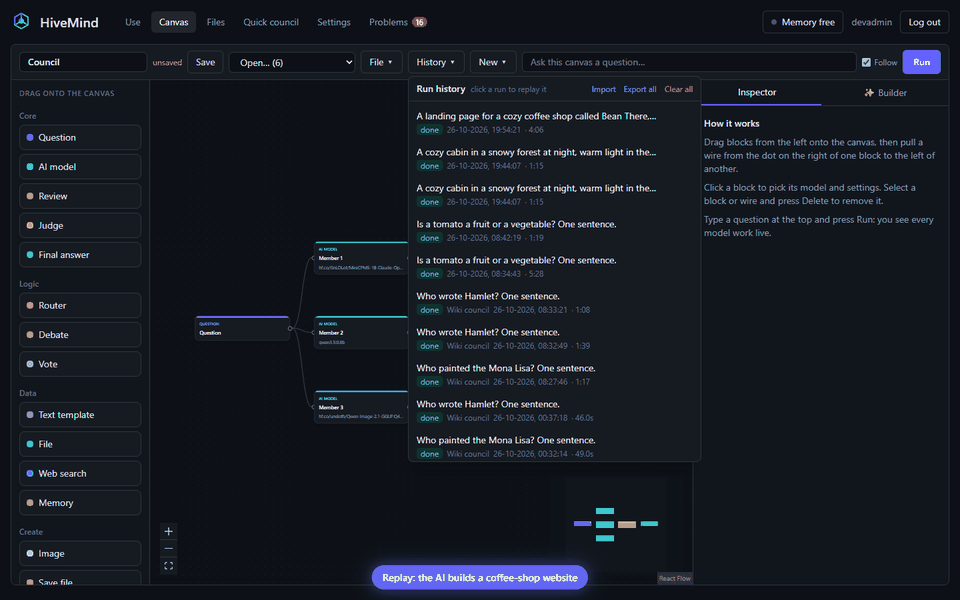
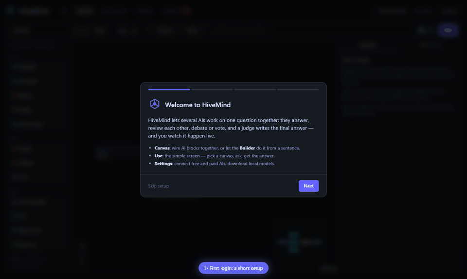
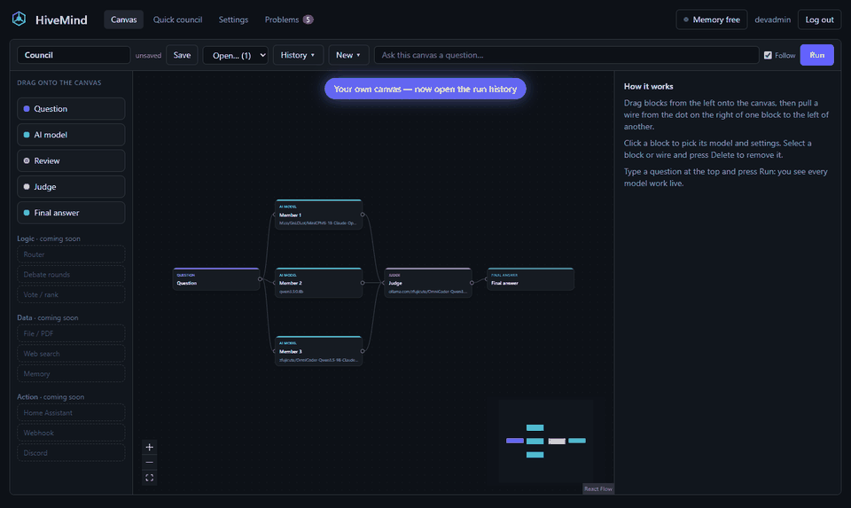
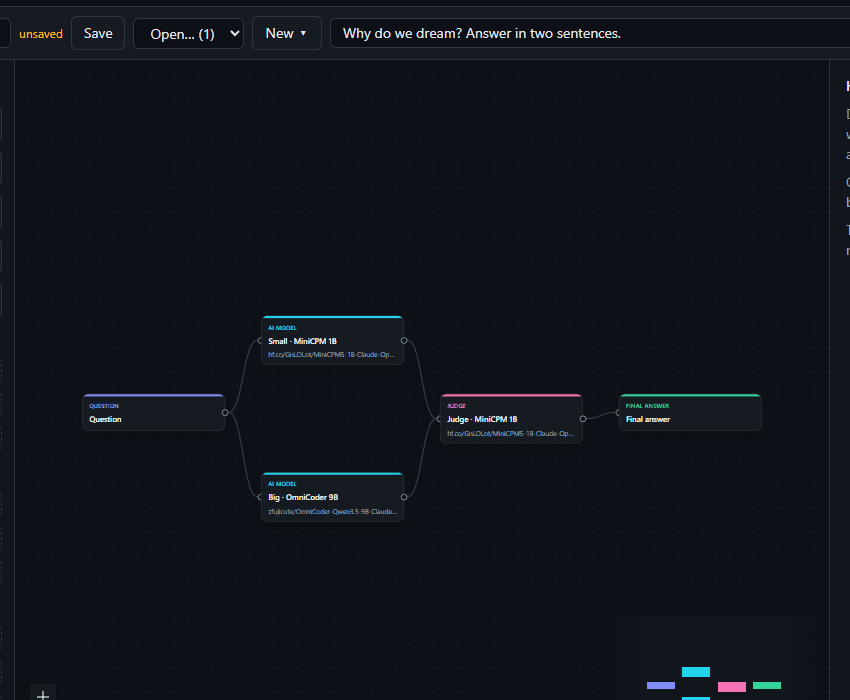
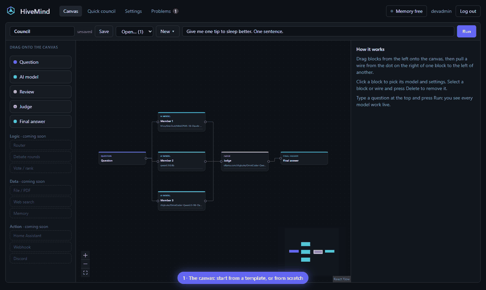
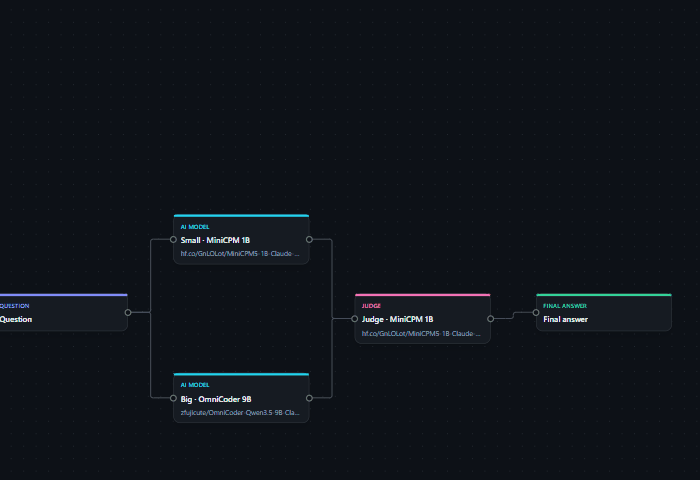
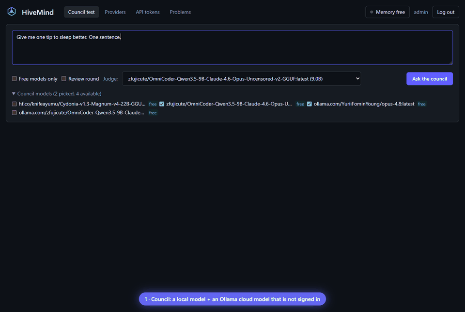
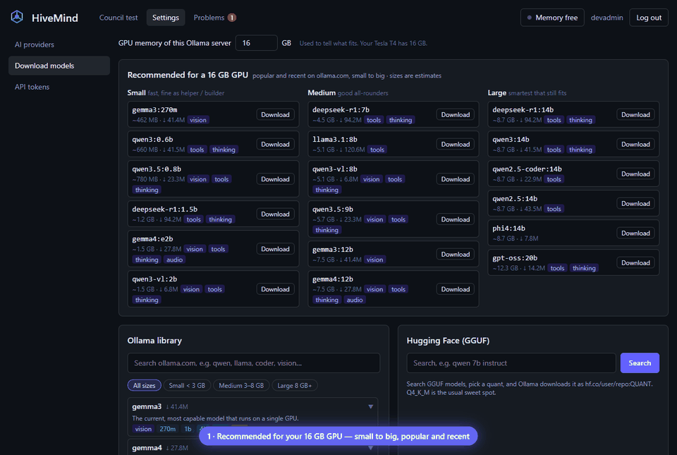
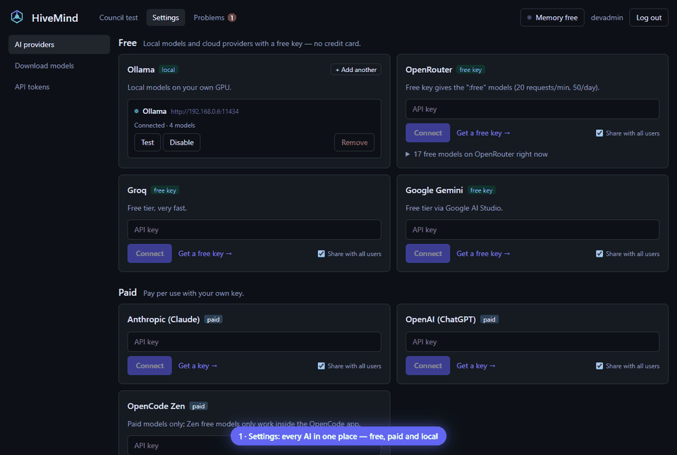

<p align="center"></p>

<h1 align="center">HiveMind</h1>
<p align="center"><b>Many AIs, one answer — and you watch them think.</b></p>

<p align="center"></p>

<p align="center"></p>

<p align="center"></p>

<p align="center"></p>

<p align="center"></p>

<p align="center"></p>

<p align="center"></p>

<p align="center"></p>

HiveMind is a self-hosted web app where several AI models work together. Ask one question: local models (Ollama) and cloud models answer it, review each other anonymously, and a judge model merges the best parts into one final answer, noting where they disagreed. Every step streams live with tokens, speed, time and cost.

> **Status: milestone 7.** On top of everything before it: the API changes for [DungeonMind](docs/HIVEMIND_CHANGES.md) (run variables, JSON mode, memory search, per-block outputs, limited tokens…), **decision models** (Jev, Ollama Nimble/Clef, OpenAI Decisions) with the Decide block and the Auto model, and the **Training Lab** (simulator, datasets, scoreboard). The Android app is next on the [roadmap](#roadmap).

## Features (now)

- **Decision models (Jev):** TypeSafe Jev, Ollama decision models (Nimble, Tev1, Clef — local on your GPU) and OpenAI Decisions answer yes/no, choice and score questions with probabilities in ~0.1 s. The **Decide** block branches on the answers (with live probability bars), the **Auto (Jev router)** model picks a small / medium / large model per question, the **Router** can decide with Jev, **Judge / Vote** can pre-score answers with Jev, and an optional canvas router sends voice to the right canvas. See [docs/decisions.md](docs/decisions.md).
- **Training Lab** (D&D, for DungeonMind): simulated games with fake players (reckless fighter, rules-lawyer, rogue, healer, typo-heavy casual), a mini bookkeeper, a Jev fast-pass rules-checker plus an LLM judge, a review queue, JSONL export for fine-tuning and a scoreboard to compare models on the same seeded games. Runs in the background until stopped and always lets real runs use the GPU first. See [docs/lab.md](docs/lab.md).
- **For apps like DungeonMind:** run variables (`vars` → `{{vars.name}}`), chat history over `/v1`, **JSON mode** per block (checked and repaired once), a context size per block (`num_ctx`), per-block **outputs** on `GET /api/runs/:id`, memory **search** (SQLite FTS5) with **bulk import**, templated memory keys, image batches (1–8 pictures), API tokens **limited** to some canvases and memory keys, and feature flags on `/api/health`. See [docs/HIVEMIND_CHANGES.md](docs/HIVEMIND_CHANGES.md).
- **Roles:** admin (everything), user (own canvases and AI keys), viewer (only uses shared canvases in Use mode, with voice and API tokens). Admins manage people in **Settings → Users**; the server checks the role on every write. **Share** on a canvas lets everyone use it (it runs with the sharer's AI providers).
- **Stats:** every model call is counted: tokens in/out, cost (provider prices, else a [pricing table](server/src/services/pricing.ts) for OpenAI / Anthropic; free and local models count as $0) and speed. The **Stats** tab shows cost per day, provider and model, tokens/sec per model, and a **leaderboard** of how often each model's answer is picked by a Judge (it names the best answer) or wins a Vote.
- **Export a run** as Markdown, JSON or PDF (the browser's print view → Save as PDF), from History, Use mode and the canvas answer — or as a ZIP with its files.
- **OpenAI-compatible API:** every saved canvas is a “model” at `http://<server>:4820/v1` — `GET /v1/models`, `POST /v1/chat/completions` (streaming too) with your API token. Works with Home Assistant, Open WebUI, the `openai` package or anything that speaks OpenAI. See [docs/openai-api.md](docs/openai-api.md).
- **Voice:** 🎤 in Use mode and on the Question block (record → transcribe → run) and 🔊 Read aloud on answers. Speech to text through any OpenAI-compatible server (Groq Whisper free, OpenAI, a local speaches / faster-whisper); text to speech with the browser's voice or an OpenAI-compatible speech server (OpenAI, local Kokoro / Piper). See [docs/voice.md](docs/voice.md).
- **Action blocks:** **Home Assistant** (read entity states, call services with templated JSON), **Webhook / HTTP** (any method, headers, body template; passes the response on) and **Discord** (post to a channel webhook). Failures show on the block and in Problems. See [docs/action-blocks.md](docs/action-blocks.md).
- **Home Assistant integration:** a custom integration ([`integrations/home_assistant`](integrations/home_assistant)) — config flow, an Assist conversation agent and a button per canvas, and a `hivemind.run_canvas` action that returns the answer. Works on HA OS and HA Docker over plain HTTP.
- **Images:** an Image block draws with your own **ComfyUI** (its checkpoints and LoRAs, fully local) or an OpenAI-compatible image API. Ollama and ComfyUI on the same GPU take turns automatically.
- **Files & websites:** a files folder (upload, preview, download), a Save file block (website, Markdown, code, JSON, CSV), and a sandboxed live **preview** of websites the AIs build.
- **Export / import:** canvases as files or a ZIP, finished tasks as ZIPs (answer, every block's output, images, replay data) — and back in again.
- **Ready-made sets:** Everyday, Coding, Creative, Home / research, Website, Decisions (spam check, smart router, safe action) and Tabletop (the DungeonMind canvases) templates.
- **Parallel switch:** cloud AIs always run at the same time; local models one by one, or together when you switch it on.
- **Builder AI:** tell it what you need ("search Wikipedia, then two models answer and a judge merges them") and it builds or changes the canvas with the models you really have. A setup wizard helps you pick its model.
- **Use mode:** the simple screen — pick a canvas, ask, get the answer, with a compact view of how it was made.
- **Logic blocks:** Router (a model or Jev picks the branch), Decide (a decision model answers typed questions and branches), Debate (models improve each other over rounds), Vote (models pick the best answer).
- **Data blocks:** Text template, File (txt, md, csv, json, PDF), Web search (Wikipedia free; Brave, Tavily or your own SearXNG), Memory (remember, recall the newest, or **search** the best matches — e.g. one rule out of a whole rulebook).
- **Drag-and-drop canvas:** build your own AI teams — drag in models, reviewers and judges, wire them together, pick a model per block (with search and a free filter), save and reuse them. Templates for council, council + review and draft → improve. Run it and every block shows live what it is doing.

- **Providers:** Ollama (local, models listed automatically), any OpenAI-compatible API, Anthropic (Claude). Presets for **OpenRouter** (free `:free` models), **Groq** and **Google Gemini** (free tiers), OpenAI, OpenCode Zen and custom URLs.
- **Council run:** question → N models → optional anonymous review round → judge → final answer.
- **Run history + replay:** every run is kept; pick one and it plays again on the canvas exactly as it happened (same timing, animations and camera), at 1×–10× speed, with a slider to jump anywhere.
- **Live animations:** a spinning aura around every working block (amber loading, violet thinking, cyan writing), a pulsing brain-core with the model's real thoughts floating up, the answer typing live, particles flowing along the wires, a green burst when a block finishes, and a camera that follows the active block.
- **Real GPU bars for local models:** waiting for the GPU → loading into it (timed against that model's last real load on your server) → loaded / already in GPU, plus a separate thinking / writing bar with tokens and speed.
- **Local models run one at a time** per Ollama host (no VRAM fights), cloud models run in parallel.
- **Live event stream (SSE)** for every step: queued, loading into VRAM, thinking, streaming, done, error — with token counts, tokens/sec, time and cost. Runs are stored and can be replayed.
- **Crash feedback:** nothing fails silently. Server crashes, failed models, provider errors and page errors show up live (red banners, toasts) and are kept in a **Problems** tab, also after a restart.
- **Free memory:** the header shows which Ollama models sit in RAM/VRAM and unloads one or all with a click.
- **Settings page:** one card per AI — Claude, ChatGPT, free OpenRouter/Groq/Gemini, Ollama, any OpenAI-compatible server. Paste a key, it tests itself.
- **Download models into Ollama:** live search of the whole Ollama library, recommendations small to big for your GPU size (fits / slow / too big), or Hugging Face GGUF search with every quant and its size; live progress and delete.
- **Accounts:** first visitor creates the admin; users, per-user **API tokens** (`Authorization: Bearer hm_…`) for apps and Home Assistant. Provider keys are stored encrypted (AES-256-GCM).

<p align="center"></p>

<p align="center"></p>

<p align="center"></p>

## Run it

### Docker

```bash
docker run -d --name hivemind -p 4820:4820 \
  -v ./hivemind-data:/data \
  -e OLLAMA_URL=http://192.168.1.10:11434 \
  ghcr.io/turkushan490/hivemind:latest
```

Or use [`docker-compose.yml`](docker-compose.yml). Open `http://<server>:4820` and create the admin account.

### Unraid

Add the template URL in Docker → Add Container → Template repositories, or install from Community Apps once listed:

```
https://raw.githubusercontent.com/turkushan490/hivemind/main/unraid/hivemind.xml
```

Set `OLLAMA_URL` to your Ollama container (e.g. `http://192.168.1.10:11434`). Update later with [`unraid/update.sh`](unraid/update.sh) or *Check for updates* in the Docker tab.

#### Getting listed in Community Applications

The template ([`unraid/hivemind.xml`](unraid/hivemind.xml)) and the maintainer profile ([`ca_profile.xml`](ca_profile.xml), in the repository root where CA looks for it) are ready. To submit:

1. **Check the template.** In Unraid, add the template URL above under Docker → Template repositories and install it once. Every field should show a description, the icon should load, and the WebUI link should work.
2. **Open a support thread.** Post in the Unraid forum's *Docker Containers* section ("[Support] HiveMind"). CA moderators expect one per app. Put its URL in `<Support>` in `hivemind.xml` (it points at GitHub issues now) and push.
3. **Submit the repository.** Use the Community Applications submission form linked from the CA policies post in the Unraid forum. Give it this repository's URL; CA reads every `*.xml` template in it plus `ca_profile.xml`.
4. **Keep it current.** CA re-reads the template from `main` automatically. Update `<Changes>` with each release, and keep `<Beta>true</Beta>` until a tagged stable version exists.

| Variable | Default | What it does |
|---|---|---|
| `PORT` | `4820` | Web port |
| `OLLAMA_URL` | `http://localhost:11434` | First Ollama provider on a fresh install |
| `SECRET_KEY` | generated in `/data` | Encrypts stored API keys |
| `SECURE_COOKIES` | `false` | `true` when served over HTTPS (also needed for the microphone on other devices) |
| `COMFYUI_URL` | empty | Optional ComfyUI, added once as an image provider |
| `TYPESAFE_API_KEY` | empty | Optional TypeSafe key, added once (encrypted) as the Jev decision provider |
| `LOG_LEVEL` | `info` | Container log detail (`debug`, `info`, `warn`, `error`) |

### Home Assistant

Both directions work:

- **HiveMind → Home Assistant:** in **Settings → Home Assistant** enter your HA address (e.g. `http://192.168.1.20:8123`) and a long-lived access token (HA profile → Security). Home Assistant blocks can then read sensors and call services.
- **Home Assistant → HiveMind:** install the [HiveMind integration](integrations/home_assistant/README.md) with an API token from **Settings → API tokens**. Each canvas becomes an Assist agent and a button, plus the `hivemind.run_canvas` action.

### Free models

| Provider | How to get it free |
|---|---|
| Ollama | Runs on your own GPU — no key |
| OpenRouter | Free key at openrouter.ai, use models ending in `:free` (20/min, 50/day) |
| Groq | Free key at console.groq.com |
| Google Gemini | Free key at aistudio.google.com |

OpenCode Zen's free models (like Big Pickle) only work inside the OpenCode app, so HiveMind supports Zen's paid models only.

## API

### OpenAI-compatible (per canvas)

```bash
curl http://server:4820/v1/chat/completions \
  -H "Authorization: Bearer hm_..." -H "Content-Type: application/json" \
  -d '{"model": "<canvas id or name>", "messages": [{"role": "user", "content": "Why is the sky blue?"}]}'
```

`GET /v1/models` lists your canvases (plus `auto` when the canvas router is on). Add `"stream": true` for server-sent chunks; send the whole conversation and it fills `{{history}}`; `hivemind_vars` fills `{{vars.name}}`. **Settings → OpenAI API** shows your base URL, canvas ids and copyable examples. Details: [docs/openai-api.md](docs/openai-api.md).

### Native

```bash
# Run a saved canvas or an ad-hoc graph, with optional variables for {{vars.name}}
curl -H "Authorization: Bearer hm_..." -H "content-type: application/json" \
  -d '{"question":"Why is the sky blue?","canvasId":"...","vars":{"tone":"short"}}' http://server:4820/api/runs
# → {"runId":"..."}; then stream events:
curl -N -H "Authorization: Bearer hm_..." http://server:4820/api/runs/<runId>/events
# the result, with the output of every labelled block:
curl -H "Authorization: Bearer hm_..." http://server:4820/api/runs/<runId>
# memory: import a rulebook and search it
curl -H "Authorization: Bearer hm_..." -H "content-type: application/json" \
  -d '{"replace":true,"entries":[{"text":"Grapple: …"}]}' http://server:4820/api/memory/keys/rules:srd51/import
curl -H "Authorization: Bearer hm_..." -H "content-type: application/json" \
  -d '{"query":"grapple","limit":3}' http://server:4820/api/memory/keys/rules:srd51/search
```

**Settings → API tokens** can limit a token to some canvases and memory keys (`dnd-*`, `rules:*`): it then can't reach anything else. All endpoints and errors for DungeonMind: [docs/HIVEMIND_CHANGES.md](docs/HIVEMIND_CHANGES.md).

## Development

```bash
npm install
npm test
npm run build
npm run dev:server   # API on :4820
npm run dev:web      # UI on :5173 (proxies /api and /v1)
```

Layout: `packages/shared` (canvas + event types), `server` (Fastify, providers, engine, SQLite via `node:sqlite`; the Lab in `server/src/lab`), `web` (React + Vite + Tailwind; the Lab in `web/src/lab`), `integrations/home_assistant` (the Home Assistant custom integration, Python; its tests run with `pytest`, see its README).

## Roadmap

1. ✅ Engine, providers, login, council test page, Docker/Unraid
2. ✅ Drag-and-drop canvas editor (React Flow): wire any models together, save canvases
3. ✅ Neon live view: particles running along wires, timings, camera following the active step, replay
4. ✅ Helper AI that builds canvases for you, setup wizard, simple "Use" mode, logic and data nodes
5. ✅ Voice (speech in/out), OpenAI-compatible API per canvas, Home Assistant integration, action nodes
6. ✅ Roles, cost stats, judge winner stats, export, Unraid Community Apps template
7. ✅ API for DungeonMind (M0), decision models (Jev, Decide block, Auto model), Training Lab L1–L2
8. Lab L3–L4 (fine-tuning on a local GPU / Hugging Face) · Android app

## License

[AGPL-3.0](LICENSE). For a commercial license without AGPL obligations, open an issue.
