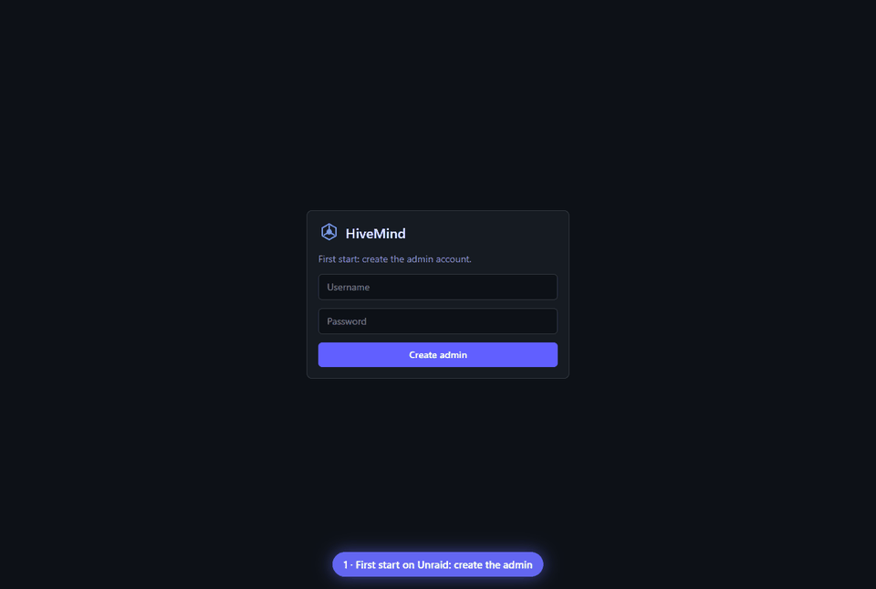

<p align="center"></p>

<h1 align="center">HiveMind</h1>
<p align="center"><b>Many AIs, one answer — and you watch them think.</b></p>

<p align="center"></p>

HiveMind is a self-hosted web app where several AI models work together. Ask one question: local models (Ollama) and cloud models answer it, review each other anonymously, and a judge model merges the best parts into one final answer, noting where they disagreed. Every step streams live with tokens, speed, time and cost.

> **Status: early (milestone 1).** The engine, providers, login and a plain council test page work. The drag-and-drop canvas, animated live view, helper AI, voice, Home Assistant integration and Android app are on the [roadmap](#roadmap).

## Features (now)

- **Providers:** Ollama (local, models listed automatically), any OpenAI-compatible API, Anthropic (Claude). Presets for **OpenRouter** (free `:free` models), **Groq** and **Google Gemini** (free tiers), OpenAI, OpenCode Zen and custom URLs.
- **Council run:** question → N models → optional anonymous review round → judge → final answer.
- **Local models run one at a time** per Ollama host (no VRAM fights), cloud models run in parallel.
- **Live event stream (SSE)** for every step: queued, loading into VRAM, thinking, streaming, done, error — with token counts, tokens/sec, time and cost. Runs are stored and can be replayed.
- **Accounts:** first visitor creates the admin; users, per-user **API tokens** (`Authorization: Bearer hm_…`) for apps and Home Assistant. Provider keys are stored encrypted (AES-256-GCM).

## Run it

### Docker

```bash
docker run -d --name hivemind -p 4820:4820 \
  -v ./hivemind-data:/data \
  -e OLLAMA_URL=http://192.168.1.10:11434 \
  ghcr.io/turkushan490/hivemind:latest
```

Or use [`docker-compose.yml`](docker-compose.yml). Open `http://<server>:4820` and create the admin account.

### Unraid

Add the template URL in Docker → Add Container → Template repositories, or install from Community Apps once listed:

```
https://raw.githubusercontent.com/turkushan490/hivemind/main/unraid/hivemind.xml
```

Set `OLLAMA_URL` to your Ollama container (e.g. `http://192.168.1.10:11434`).

| Variable | Default | What it does |
|---|---|---|
| `PORT` | `4820` | Web port |
| `OLLAMA_URL` | `http://localhost:11434` | First Ollama provider on a fresh install |
| `SECRET_KEY` | generated in `/data` | Encrypts stored API keys |
| `SECURE_COOKIES` | `false` | `true` when served over HTTPS |

### Free models

| Provider | How to get it free |
|---|---|
| Ollama | Runs on your own GPU — no key |
| OpenRouter | Free key at openrouter.ai, use models ending in `:free` (20/min, 50/day) |
| Groq | Free key at console.groq.com |
| Google Gemini | Free key at aistudio.google.com |

OpenCode Zen's free models (like Big Pickle) only work inside the OpenCode app, so HiveMind supports Zen's paid models only.

## API

```bash
# Run a saved canvas or an ad-hoc graph
curl -H "Authorization: Bearer hm_..." -H "content-type: application/json" \
  -d '{"question":"Why is the sky blue?","canvasId":"..."}' http://server:4820/api/runs
# → {"runId":"..."}; then stream events:
curl -N -H "Authorization: Bearer hm_..." http://server:4820/api/runs/<runId>/events
```

## Development

```bash
npm install
npm test
npm run build
npm run dev:server   # API on :4820
npm run dev:web      # UI on :5173 (proxies /api)
```

Layout: `packages/shared` (canvas + event types), `server` (Fastify, providers, engine, SQLite via `node:sqlite`), `web` (React + Vite + Tailwind).

## Roadmap

1. ✅ Engine, providers, login, council test page, Docker/Unraid
2. Drag-and-drop canvas editor (React Flow): wire any models together, save canvases
3. Neon live view: particles running along wires, timings, camera following the active step, replay
4. Helper AI that builds canvases for you, setup wizard, simple "Use" mode, logic and data nodes
5. Voice (speech in/out), OpenAI-compatible API per canvas, Home Assistant integration, action nodes
6. Roles, cost stats, judge winner stats, export
7. Android app

## License

[AGPL-3.0](LICENSE). For a commercial license without AGPL obligations, open an issue.
