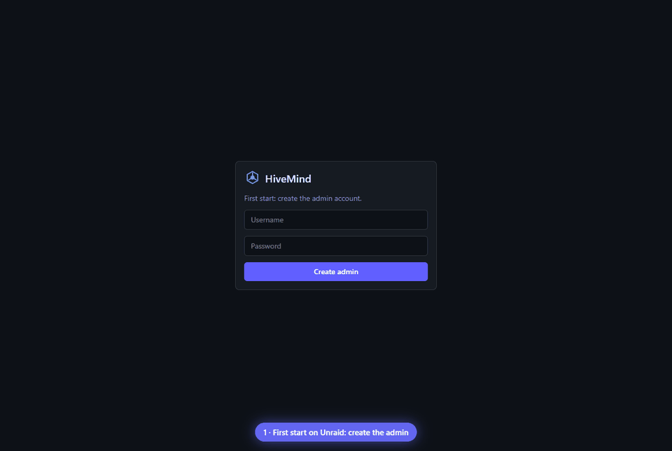
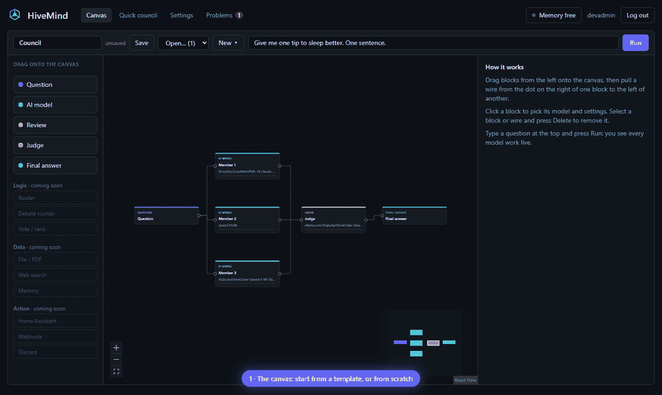
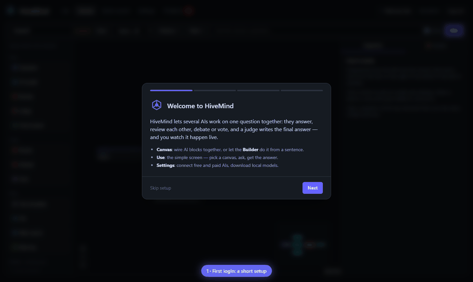
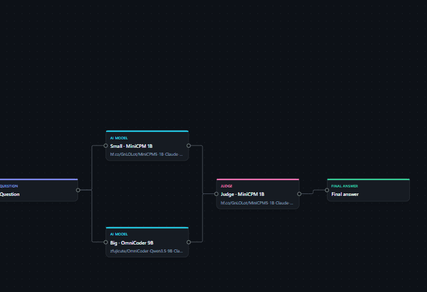
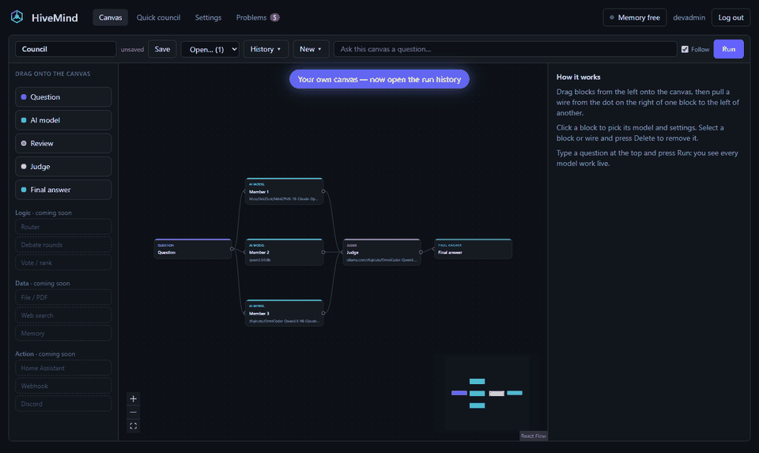
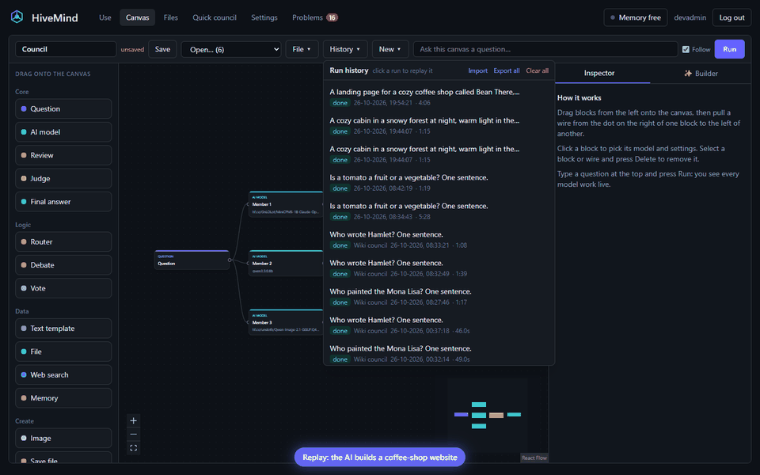
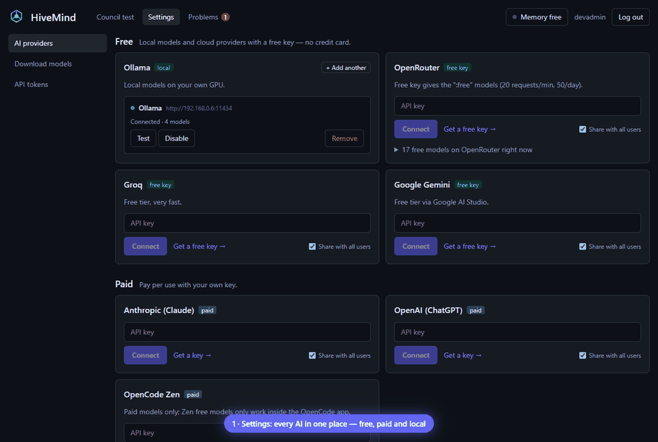

<p align="center"></p>

<h1 align="center">HiveMind</h1>
<p align="center"><b>Many AIs, one answer — and you watch them think.</b></p>

HiveMind is a self-hosted web app where several AI models work together on a canvas of blocks.
Local models (Ollama, the built-in Colibri engine) and cloud models answer, review each other and a judge merges the best answer.
It also does chat and voice, pictures with ComfyUI, websites, memory, skills, an OpenAI-compatible API and a HiveBot robot companion.

<p align="center"></p>

**Contents:** [Features](#features) · [Quick start](#quick-start) · [Your first chat in 5 minutes](#your-first-chat-in-5-minutes) · [Ready-made workflows](#ready-made-workflows) · [Guides](#guides) · [Development](#development)

## Features

- **Canvas of blocks:** drag in models, reviewers, judges, search, files and actions, wire them together and run. Every block shows live what it is doing.
- **Builder AI:** describe what you want in one sentence and it builds the canvas with the models you really have.
- **Local and cloud models:** Ollama (with model downloads), Colibri for very large models, OpenAI, Anthropic, OpenRouter, Groq, Gemini and any OpenAI-compatible server.
- **Live GPU view:** GPU bars per block (waiting, loading, loaded) and a priority queue (1–200), so jobs share one GPU in the right order.
- **Replay:** every run is saved and can be played back on the canvas.
- **Websites and files:** AIs build websites into projects, with a live preview, an editor and Git.
- **Images:** Image blocks draw with your own ComfyUI or an image API.
- **Chat and voice:** ask your workflows with the microphone and hear the answer.
- **Memory and skills:** Markdown memory files the models read and write, and `SKILL.md` skills they follow.
- **HiveBot:** a robot companion with its own characters, voices and background jobs.
- **API:** every saved canvas is a model on an OpenAI-compatible `/v1` API.
- **Users and stats:** admin / user / viewer roles, access profiles, cost and speed stats, a model leaderboard.

| Build a canvas | Builder AI |
|---|---|
|  |  |
| **Live GPU bars** | **Replay a run** |
|  |  |
| **Websites and files** | **Models and providers** |
|  |  |
| **Voice** | **Memory** |
|  |  |
| **HiveBot** | **Colibri** |
|  |  |

> **TODO — screenshots to take** (save them in `docs/img/`).
> The `docs/img/` images above show as broken until these are taken:
>
> - [ ] `docs/img/voice.gif` — Use mode: press 🎤, ask, hear the answer
> - [ ] `docs/img/memory-page.png` — the Memory page with a few files
> - [ ] `docs/img/skills-page.png` — the Skills page with an imported skill
> - [ ] `docs/img/hivebot.png` — the HiveBot page with its characters
> - [ ] `docs/img/colibri.png` — Settings → Colibri with the library
> - [ ] `docs/img/setup-wizard.png` — the setup wizard after the first login
> - [ ] `docs/img/use-mode.png` — Use mode with an answer
> - [ ] `docs/img/unraid-template.png` — the Unraid template form

## Quick start

HiveMind listens on port **4820**. All data (database, files, keys) lives in one folder: `/data` in Docker.
In the examples, replace `your-server` with the name or address of the machine that runs it.

### Unraid

1. Go to **Docker → Add Container**, and under *Template repositories* add:
   ```
   https://raw.githubusercontent.com/turkushan490/hivemind/main/unraid/hivemind.xml
   ```
   (or search **HiveMind** in Community Applications once it is listed).
2. Set **Ollama URL** to your Ollama server, for example `http://your-server:11434`. Use the real address, not `localhost`. Leave it empty if you only use cloud AIs.
3. Optional: set **ComfyUI URL** for local pictures.
4. Click **Apply** and open the WebUI: `http://your-server:4820`.

The template already passes `--gpus=all`. If you have no NVIDIA GPU (or no Nvidia driver plugin), remove `--gpus=all` from *Extra Parameters*; everything except training and Colibri's GPU mode still works.

### Docker

Without a GPU:

```bash
docker run -d --name hivemind --restart unless-stopped \
  -p 4820:4820 \
  -v ./hivemind-data:/data \
  -e OLLAMA_URL=http://your-server:11434 \
  -e TZ=Etc/UTC \
  ghcr.io/turkushan490/hivemind:latest
```

With an NVIDIA GPU (needs the [NVIDIA Container Toolkit](https://docs.nvidia.com/datacenter/cloud-native/container-toolkit/latest/install-guide.html)), add `--gpus=all`:

```bash
docker run -d --name hivemind --restart unless-stopped --gpus=all \
  -p 4820:4820 \
  -v ./hivemind-data:/data \
  -e OLLAMA_URL=http://your-server:11434 \
  -e TZ=Etc/UTC \
  ghcr.io/turkushan490/hivemind:latest
```

The GPU is used by the Training Lab, Colibri (CUDA), the built-in voice engine and fast speech-to-text. Ollama and ComfyUI run in their own containers and use the GPU there.

#### Docker compose

The repository has a ready [`docker-compose.yml`](docker-compose.yml). Download it and start:

```bash
curl -O https://raw.githubusercontent.com/turkushan490/hivemind/main/docker-compose.yml
docker compose up -d
```

For the GPU, add this under the `hivemind:` service:

```yaml
    deploy:
      resources:
        reservations:
          devices:
            - driver: nvidia
              count: all
              capabilities: [gpu]
```

The image is large (~16 GB, it carries the training stack), so the first pull takes a while.

### Windows (.exe)

1. Download `hivemind-windows-x64.exe` from the [Releases page](https://github.com/turkushan490/hivemind/releases).
2. Double-click it. A window opens with HiveMind at `http://localhost:4820`.
3. Your data lives in `%LOCALAPPDATA%\HiveMind` (database, files, keys and `hivemind.log`).

The .exe has the same app, the built-in speech-to-text and the API. Linux-only parts are not in it: Colibri, the Training Lab and the built-in Kokoro voice. The Shell and Browser blocks need their tools (bash or PowerShell, a Chromium browser) on the PC; the Docker image has them built in. Install [Ollama for Windows](https://ollama.com/download) for local models; HiveMind finds it at `http://localhost:11434`.

### Update

- **Docker:** `docker pull ghcr.io/turkushan490/hivemind:latest` and recreate the container (`docker compose pull && docker compose up -d`).
- **Unraid:** *Check for updates* in the Docker tab, or run [`unraid/update.sh`](unraid/update.sh).
- **Windows:** download the new .exe and replace the old one. Your data stays in `%LOCALAPPDATA%\HiveMind`.

All settings are in [docs/environment.md](docs/environment.md).

## Your first chat in 5 minutes

1. **Open HiveMind** at `http://your-server:4820`. The first person to visit creates the **admin** account.
2. **Add an AI.** The setup wizard opens. Pick one:
   - **Local:** your Ollama is already there if you set `OLLAMA_URL`. No model yet? Go to **Settings → Download models** and download a small one, for example `gemma3:4b` or `qwen3:4b`.
   - **Free cloud:** get a free key at [openrouter.ai](https://openrouter.ai), [console.groq.com](https://console.groq.com) or [aistudio.google.com](https://aistudio.google.com) and paste it in **Settings → AI providers**. The card tests the key itself.
3. **Pick a canvas.** On the **Workflow** page click **New ▾ → Everyday → Council** (or *Empty canvas*). Choose a model in each AI block.
4. **Ask.** Type a question in the Question block and press **Run**. Watch the blocks load, think and write.
5. **Save** the canvas. Now it is in **Use** mode (the simple ask-and-answer screen) and on the API as a model.

Want it even simpler? Open the **Builder** panel and type: *"Two models answer, a judge merges them."*

## Ready-made workflows

Open them on the **Workflow** page with **New ▾**. A few to start with:

| Template | Group | What it does |
|---|---|---|
| **Council** | Everyday | 3 models answer, a judge merges the best parts |
| **Council + review** | Everyday | Same, with an anonymous review round first |
| **Draft → improve** | Everyday | One model writes, a second checks and improves |
| **Fact-check with Wikipedia** | Everyday | Searches Wikipedia, answers with sources |
| **Summarize a file** / **Translate** | Everyday | Ask about a PDF or text; translate with a checker |
| **HiveMind: smart router** | Everyday | Sorts each question (chat, code, writing, picture…) and sends it to the right model |
| **Coder + reviewer** | Coding | One model writes code, a second finds bugs and fixes them |
| **Bug-hunt debate** | Coding | Two models debate the bug, a judge writes the fix |
| **Software builder (project)** | Coding | Builds a software project run after run |
| **Picture from an idea** | Creative | A model writes the image prompt, your image model draws it |
| **Story + editor** / **Brainstorm + vote** | Creative | Write and polish; brainstorm and let a vote pick |
| **Deep research** | Research | Searches the web in rounds, reviews each site, writes an answer with sources |
| **Research with memory** | Home / research | Remembers what earlier runs learned |
| **Website builder** / **Site builder (project)** | Website | Builds a website with a live preview, and keeps improving it |
| **Spam check** / **Safe action (guard)** | Decisions | Fast yes/no decisions with a decision model |
| **Voice assistant** | Voice | Ask by voice, get a spoken answer |

There are more for training models, voices and tabletop games. What every block does: [docs/blocks.md](docs/blocks.md).

## Guides

| Guide | What it covers |
|---|---|
| [Blocks](docs/blocks.md) | Every block on the canvas, in 2–3 lines each |
| [Chat & Talk](docs/chat-and-talk.md) | Use mode, voice in and out |
| [Skills](docs/skills.md) | `SKILL.md` folders the models follow |
| [Memory](docs/memory.md) | Memory blocks and Markdown memory files |
| [Unlock mode](docs/unlock-mode.md) | A private, PIN-protected area |
| [Ollama & machines](docs/ollama.md) | Local models, several machines, the GPU queue |
| [Colibri](docs/colibri.md) | The built-in engine for very large models |
| [HiveBot](docs/hivebot.md) | The robot companion |
| [API](docs/api.md) | The OpenAI-compatible `/v1` API and the native API |
| [Environment variables](docs/environment.md) | Every setting for Docker, Unraid and Windows |
| [FAQ & troubleshooting](docs/faq.md) | Common problems and fixes |

More in-depth: [projects](docs/projects.md) · [action blocks](docs/action-blocks.md) · [voice](docs/voice.md) · [decision models](docs/decisions.md) · [Training Lab](docs/lab.md) · [OpenAI API details](docs/openai-api.md) · [Home Assistant integration](integrations/home_assistant/README.md) · [change log](docs/HIVEMIND_CHANGES.md)

## Development

```bash
npm install
npm test
npm run build
npm run dev:server   # API on :4820
npm run dev:web      # UI on :5173 (proxies /api and /v1)
```

Layout: `packages/shared` (canvas and event types), `server` (Fastify + TypeScript, SQLite via `node:sqlite`), `web` (React + Vite + Tailwind), `integrations/home_assistant` (the Home Assistant custom integration).

## License

[AGPL-3.0](LICENSE). For a commercial license without AGPL obligations, open an issue.
